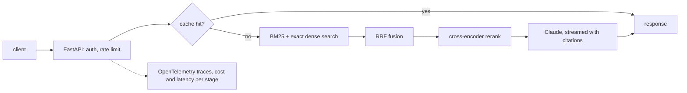

<h1 align="center">RAG Service</h1>

<p align="center">
  <a href="https://github.com/haroonkhan02/rag-service/actions/workflows/ci.yml"></a>
  
  
</p>

A production-style question-answering service over the ROS 2 documentation. It takes the
retrieval pipeline of [robotics-docs-rag](https://github.com/haroonkhan02/robotics-docs-rag)
(section chunking, BM25 + embeddings, cross-encoder reranking, cited answers from Claude)
and turns it into something you could deploy and measure: an HTTP API with caching,
streaming, rate limits, tracing, load tests and a cost per query.

**Status: work in progress.** The data pipeline, index format, search core and CI are done,
and the search reproduces robotics-docs-rag exactly (below). Next are the FastAPI service
with an exact and a semantic cache, streamed answers and a load test, then tracing, Docker
and an answer-quality evaluation with
[llm-eval-harness](https://github.com/haroonkhan02/llm-eval-harness).

## Planned design



## Results so far

The index is a plain bundle (chunks, a NumPy embedding matrix and a checksummed manifest)
searched exactly instead of through Chroma. On the 61 answerable questions of the shared
evaluation set it matches the published robotics-docs-rag numbers in every mode:

| Retrieval | MRR@10 | Hit@1 | Hit@5 | Same top-10 relevance |
|---|---|---|---|---|
| BM25 | 0.506 | 0.377 | 0.721 | 61/61 |
| Dense (BGE-small) | 0.596 | 0.459 | 0.738 | 61/61 |
| Hybrid (RRF) | 0.574 | 0.426 | 0.787 | 60/61 |
| Hybrid + rerank | 0.690 | 0.590 | 0.803 | 61/61 |

The chunk file is byte-identical to the original index once pypdf is pinned (pypdf 7 changes
the whitespace of 99 PDF chunks). One hybrid question ranks a relevant passage differently,
without changing any aggregate; exact versus approximate nearest-neighbour search is the
likely cause. Warm on an M5, a reranked search takes about 153 ms, of which 147 ms is the
cross-encoder, so that is where caching and batching have to pay off. Full table and
per-stage timings: [reports/parity.md](reports/parity.md).

## Repository structure

```text
rag-service/
├── configs/service.yaml      defaults; override with RAGSVC__SECTION__KEY env vars
├── src/ragsvc/
│   ├── config.py             typed settings, validated at start-up
│   ├── download.py           pinned corpus + eval set, SHA-256 of every file
│   ├── ingest.py, chunking.py   RST/PDF parsing and section chunking
│   ├── bundle.py             index bundle: atomic write, checksum + settings check on load
│   ├── build_index.py        corpus -> chunks -> embeddings -> bundle
│   ├── models.py             embedder and cross-encoder (lazy PyTorch import)
│   ├── search.py             BM25, exact dense, RRF, rerank
│   ├── evalset.py, parity.py    metrics and the parity check
├── reports/                  parity.md / parity.json
└── tests/                    synthetic corpus, hashing embedder; no models or network
```

## Getting started

```bash
uv venv --python 3.12 && source .venv/bin/activate
uv pip install -e ".[models,dev]"
ragsvc-download          # ROS 2 docs, 3 arXiv papers, eval set (~66 MB)
ragsvc-build-index       # ~20 s of embedding on Apple silicon
ragsvc-parity            # writes reports/parity.md
pytest -q
```

## License

MIT © 2026 Muhammad Haroon Khan. The ROS 2 documentation is CC BY 4.0; the arXiv papers are
downloaded for local indexing only and not redistributed.
