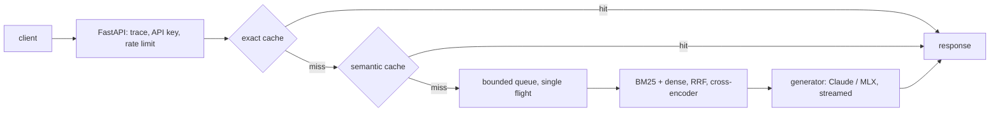

<h1 align="center">RAG Service</h1>

<p align="center">
  <a href="https://github.com/haroonkhan02/rag-service/actions/workflows/ci.yml"></a>
  
  
</p>

A production-style question-answering service over the ROS 2 documentation. It takes the
retrieval pipeline of [robotics-docs-rag](https://github.com/haroonkhan02/robotics-docs-rag)
(section chunking, BM25 + embeddings, cross-encoder reranking, cited answers) and turns it
into something you can deploy and measure: an HTTP API with caching, streaming, rate limits,
load shedding, tracing, a container image, a load test, a cost estimate and an answer
evaluation.

## What it does

- `POST /search` returns ranked passages with per-stage timings; `POST /ask` streams a
  cited answer as Server-Sent Events.
- Two caches in front of the models: exact (same question after normalisation) and
  semantic (a paraphrase close enough to a cached question).
- Per-client token-bucket rate limit (429), a bounded queue that sheds load (503), and one
  shared computation for identical questions that arrive together.
- OpenTelemetry traces, and answer backends behind one interface: Claude, a local MLX
  model, or no LLM at all.
- Answers are scored for correctness and citations; a regression gate from
  [llm-eval-harness](https://github.com/haroonkhan02/llm-eval-harness) compares two runs.



## Results

Measured on an Apple M5, one server process and one model worker. Answers come from
Qwen2.5-7B (4-bit, local, through MLX). Answers from Claude are implemented but not
measured: that requires an Anthropic API key.

**Load** (`/search`, load generator on the same machine)

| Scenario | Throughput (req/s) | p50 (ms) | p95 (ms) |
|---|---|---|---|
| Hybrid + rerank, 1 client | 7.1 | 154 | 160 |
| Hybrid + rerank, 16 clients | 7.1 | 2,264 | 2,446 |
| Hybrid without rerank, 16 clients | 127.7 | 120 | 127 |
| Skewed workload, 8 clients, no cache | 9.7 | 882 | 1,126 |
| Skewed workload, exact cache | 67.5 | 0.7 | 983 |
| Skewed workload, exact + semantic cache | 74.8 | 1.0 | 800 |

The cross-encoder caps the service at 7 searches per second; extra clients only wait
longer. With 128 clients the queue limit rejects 340 of 648 requests with a 503 and keeps
the slowest accepted one at 9.5 s. The exact cache does most of the work. The semantic
cache adds little because its threshold has to be strict: paraphrases (median similarity
0.951) and look-alike questions that ask something else (up to 0.950) overlap, so the
default of 0.96 reuses 23 of 61 paraphrases and none of 35 look-alikes.

**Where the time goes**: traces of single requests show an uncached search taking 161.5 ms,
of which 152.7 ms is the cross-encoder (embedding 5.3, BM25 1.9, dense 0.2). A semantic
cache hit costs 5.4 ms and an exact hit 0.17 ms. A local-model answer takes 2.6 s, 2.4 s of
it generation. Tracing itself adds 0.03 ms to a cache hit and nothing measurable elsewhere.

**Answers** (66 questions, 5 of them unanswerable from the corpus; top 5 passages)

| Retrieval | Correct | Correct when a relevant passage was retrieved | Correct when not | Abstained on unanswerable |
|---|---|---|---|---|
| BM25 only | 50/66 (75.8 %) | 39/44 | 6/17 | 5/5 |
| Hybrid + rerank | 55/66 (83.3 %) | 47/49 | 3/12 | 5/5 |

Most wrong answers are retrieval misses: with a relevant passage in the prompt the model is
right 47 times out of 49. The gain from reranking is 8 questions better and 3 worse, which
passes the regression gate but is not a significant improvement on 66 questions. The judge
is Qwen2.5-7B, the same model that wrote the answers, so the absolute numbers are likely
optimistic. It gets all 183 control items right; a second judge, Llama-3.2-3B, scores the
same answers higher (90 % against 82 % on answerable questions) but fails 21 controls, so I
report the stricter one.

**Cost** (token counts measured with the local model's tokenizer; dollars are estimates
at Claude list prices and exclude thinking tokens)

| | Tokens in / out | Opus 5.5 | Sonnet 5.5 | Haiku 5.5 |
|---|---|---|---|---|
| One answer (mean) | 1,283 / 63 | $0.0064 | $0.0032 | $0.0002 |
| 1,000 requests, no cache | 1,241,840 / 55,440 | $6.08 | $3.04 | $0.15 |
| 1,000 requests, exact cache | 133,598 / 6,587 | $0.67 | $0.33 | $0.017 |
| 1,000 requests, exact + semantic | 113,984 / 5,668 | $0.57 | $0.28 | $0.014 |

The prompt is 80 % of the cost, so the passage count matters more than answer length:
three passages instead of five cut the prompt to 0.66x and Hit@k from 80.3 % to 77.0 %.
The cache rows use the same skewed workload as the load test, which is built to repeat;
real savings depend on how often questions do.

Full tables: [load test](reports/load_test.md), [semantic cache](reports/semantic_cache.md),
[tracing](reports/tracing.md), [answer evaluation](reports/answer_eval.md),
[cost](reports/cost.md), [parity with robotics-docs-rag](reports/parity.md).

## Repository structure

```text
rag-service/
├── configs/service.yaml      defaults; override with RAGSVC__SECTION__KEY env vars
├── Dockerfile                index and models baked in; runs offline as a non-root user
├── eval/                     paraphrases and look-alike questions for the cache study
├── evals/                    per-question answer scores read by the regression gate
├── src/ragsvc/
│   ├── config.py             typed settings, validated at start-up
│   ├── download.py, ingest.py, chunking.py, bundle.py, build_index.py   corpus -> index
│   ├── models.py, search.py  embedder, cross-encoder; BM25, exact dense, RRF, rerank
│   ├── cache.py, ratelimit.py   exact + semantic cache; token bucket per client
│   ├── generate.py, cost.py  Claude, MLX and extractive answers, streamed; list prices
│   ├── tracing.py            OpenTelemetry spans, trace propagation, ASGI middleware
│   ├── service.py            cache -> search -> generate, single flight, load shedding
│   ├── app.py, serve.py      FastAPI routes, SSE; start-up and warm-up
│   ├── loadtest.py, load_study.py, cache_study.py, trace_study.py   the measurements
│   ├── answer_eval.py, answer_report.py, cost_study.py   answer quality and cost
│   └── evalset.py, parity.py metrics and the parity check
├── reports/                  one markdown + JSON file per study; stored answers
├── scripts/docker_smoke.sh   starts the image offline and calls the API
└── tests/                    synthetic corpus, hashing embedder; no models or network
```

## Getting started

```bash
uv venv --python 3.12 && source .venv/bin/activate
uv pip install -e ".[models,serve,dev]"      # extras: anthropic, mlx, otel, eval
ragsvc-download            # ROS 2 docs, 3 arXiv papers, eval set (~66 MB)
ragsvc-build-index         # ~20 s of embedding on Apple silicon
ragsvc-serve               # http://127.0.0.1:8000
```

```bash
curl -s localhost:8000/search -H 'content-type: application/json' \
  -d '{"query": "How do I record only two topics into a bag?"}'
curl -N localhost:8000/ask -H 'content-type: application/json' \
  -d '{"query": "What replaces latched topics in ROS 2?"}'
```

Answers from Claude require an Anthropic API key in `ANTHROPIC_API_KEY`. Without one, set
`RAGSVC__GENERATION__BACKEND=mlx` (local model, Apple silicon) or `extractive` (quotes the
top passage). `RAGSVC_API_KEYS=key1,key2` makes an `X-API-Key` header mandatory.
`RAGSVC__TRACING__ENABLED=true` sends spans over OTLP/HTTP to
`OTEL_EXPORTER_OTLP_ENDPOINT`.

```bash
docker build -t rag-service . && docker run -p 8000:8000 rag-service
```

The image builds the index and bundles both retrieval models, so the container needs no
network. It answers without an LLM unless you pass the backend and key.

```bash
ragsvc-loadtest && ragsvc-cache-study && ragsvc-trace-study    # reports/*.md
ragsvc-answer-eval generate --name hybrid_rerank    # then: judge, report
ragsvc-cost && pytest -q
```

## Design decisions

| Decision | Why |
|---|---|
| Exact NumPy search instead of a vector database | 3,680 chunks: a matrix product takes 0.2 ms and gives the same result on every machine |
| One model worker and a bounded queue | The models share one GPU; an unbounded queue turns overload into timeouts for everyone |
| Semantic hits are not stored under the new wording | Otherwise reuse chains (A serves B, B serves C) drift from the question that was searched |
| Truncated and refused answers are never cached | A cache should not make one bad answer permanent |
| Span parents are passed explicitly | A streamed response resumes in another task, where OpenTelemetry's context variables cannot be detached |
| The index is built inside the image | Every container serves the same checksummed index and starts without network access |

## Limitations

- One process: caches and rate-limit buckets live in memory, so replicas would not share
  them. Redis for both is the usual fix.
- Throughput with reranking is bounded by one cross-encoder pass per query. Batching
  several queries into one pass is the next thing to try.
- The load generator shares the machine with the service, and every load scenario except
  the rate-limit one is closed loop, which understates latency under real overload.
- The paraphrase and look-alike sets are small and written by me with the docs in mind; the
  paraphrases retrieve better than the original questions (Hit@5 0.885 against 0.803).
- Answer quality is judged by small local models on 66 questions I wrote. Claude answers,
  real Claude token counts and thinking tokens are not measured.
- The container image (2 GB) is built and smoke-tested in CI only, with the no-LLM backend;
  on the CI runner's CPU the cross-encoder takes 2.6 s per search.

## License

MIT © 2026 Muhammad Haroon Khan. The ROS 2 documentation is CC BY 4.0; the arXiv papers are
downloaded for local indexing only and not redistributed.
