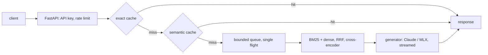

<h1 align="center">RAG Service</h1>

<p align="center">
  <a href="https://github.com/haroonkhan02/rag-service/actions/workflows/ci.yml"></a>
  
  
</p>

A production-style question-answering service over the ROS 2 documentation. It takes the
retrieval pipeline of [robotics-docs-rag](https://github.com/haroonkhan02/robotics-docs-rag)
(section chunking, BM25 + embeddings, cross-encoder reranking, cited answers from Claude)
and turns it into something you could deploy and measure: an HTTP API with caching,
streaming, rate limits, load shedding and a load test.

**Status: work in progress.** The service, both caches, streamed answers, rate limiting and
the load test are done and measured below. Answers from Claude are implemented but not
measured here, because that requires an Anthropic API key; the streaming numbers use a
local open-weight model instead. Still to come: tracing, Docker, cost per query and an
answer-quality evaluation with
[llm-eval-harness](https://github.com/haroonkhan02/llm-eval-harness).

## What it does

- `POST /search` returns ranked passages with per-stage timings; `POST /ask` streams a
  cited answer as Server-Sent Events.
- Two caches in front of the models: exact (same question after normalisation) and
  semantic (a paraphrase close enough to a cached question).
- Identical questions that arrive together share one computation.
- Per-client token-bucket rate limit (429) and a bounded queue that sheds load (503)
  instead of letting latency grow.
- Answer backends behind one interface: Claude, a local MLX model, or no LLM at all.



## Results

All numbers are from an Apple M5 with the service and the load generator on the same
machine, one server process and one model worker.

**Search under load** (`/search`, caches off, 162 distinct questions, closed loop):

| Mode | Clients | Throughput (req/s) | p50 (ms) | p95 (ms) |
|---|---|---|---|---|
| Hybrid + rerank | 1 | 7.1 | 154 | 160 |
| Hybrid + rerank | 16 | 7.1 | 2,264 | 2,446 |
| Hybrid (no rerank) | 1 | 115.0 | 8 | 10 |
| Hybrid (no rerank) | 16 | 127.7 | 120 | 127 |

The cross-encoder is the whole budget: it caps the service at 7 searches per second, and
extra clients only add queueing time. With 128 clients the queue limit of 64 keeps the
slowest accepted request at 9.5 s and rejects 340 of 648 requests with a 503 straight away.

**Caching** (1,000 requests, Zipf-distributed over 66 questions, 30 % paraphrased, 8 clients):

| Cache | Throughput (req/s) | p50 (ms) | p95 (ms) | Searches computed |
|---|---|---|---|---|
| None (single flight only) | 9.7 | 882 | 1,126 | 775 |
| Exact | 67.5 | 0.7 | 983 | 105 |
| Exact + semantic (0.96) | 74.8 | 1.0 | 800 | 92 |

The exact cache does almost all of the work. The semantic cache removes only 13 more
searches, because the threshold has to be strict to be safe:

| Threshold | Paraphrases reused (of 61) | Near misses reused (of 35) | Hit@5 of what is served |
|---|---|---|---|
| 0.90 | 53 | 10 | 0.820 |
| 0.94 | 37 | 3 | 0.836 |
| 0.96 (default) | 23 | 0 | 0.869 |
| no reuse | 0 | 0 | 0.885 |

A near miss is a question that looks like a cached one but asks something else ("record
all topics" against "record only two topics", similarity 0.950). Paraphrases and near
misses overlap in similarity, so no threshold separates them: 0.96 reuses 38 % of the
paraphrases with no wrong reuse on these sets. Even a correct reuse costs some retrieval
quality, since the passages were ranked for the other wording. The threshold is picked on
the same questions it is reported on, so new traffic can do worse.

**Streamed answers** (`/ask`, Qwen2.5-7B 4-bit running locally through MLX, 20 questions):

| Run | Time to first token, p50 | Total, p50 | Total, p95 |
|---|---|---|---|
| One client, new questions | 1.46 s | 2.99 s | 5.08 s |
| Same questions again (answer cache) | 0.5 ms | 0.6 ms | 0.7 ms |
| Four clients, new questions | 14.1 s | 18.4 s | 24.2 s |

These describe a laptop model, not Claude. The local model generates one answer at a time,
so four clients mostly wait in line; a hosted model would not have that queue. Answer
quality is not judged yet.

Rate limit: a client sending 20 req/s against a 5 req/s limit with a burst of 20 gets 69
of 200 requests through (the token bucket predicts 70) and 429 with `Retry-After` for the
rest. The search core reproduces the published robotics-docs-rag retrieval numbers exactly
(hybrid + rerank MRR@10 0.690). Full tables: [load test](reports/load_test.md),
[semantic cache](reports/semantic_cache.md), [parity](reports/parity.md).

## Repository structure

```text
rag-service/
├── configs/service.yaml      defaults; override with RAGSVC__SECTION__KEY env vars
├── eval/                     paraphrases and near-miss questions for the cache study
├── src/ragsvc/
│   ├── config.py             typed settings, validated at start-up
│   ├── download.py, ingest.py, chunking.py, bundle.py, build_index.py   corpus -> index
│   ├── models.py, search.py  embedder, cross-encoder; BM25, exact dense, RRF, rerank
│   ├── cache.py              exact + semantic query cache (LRU, TTL)
│   ├── ratelimit.py          token bucket per client
│   ├── generate.py           Claude, MLX and extractive answer backends, streamed
│   ├── service.py            cache -> search -> generate, single flight, load shedding
│   ├── app.py, serve.py      FastAPI routes, SSE; start-up and warm-up
│   ├── cache_study.py        semantic-cache threshold study
│   ├── loadtest.py, load_study.py   load generator and scenarios
│   └── evalset.py, parity.py metrics and the parity check
├── reports/                  load_test, semantic_cache, parity (md + json)
└── tests/                    synthetic corpus, hashing embedder; no models or network
```

## Getting started

```bash
uv venv --python 3.12 && source .venv/bin/activate
uv pip install -e ".[models,serve,dev]"      # add ",anthropic" or ",mlx" for answers
ragsvc-download            # ROS 2 docs, 3 arXiv papers, eval set (~66 MB)
ragsvc-build-index         # ~20 s of embedding on Apple silicon
ragsvc-serve               # http://127.0.0.1:8000
```

```bash
curl -s localhost:8000/search -H 'content-type: application/json' \
  -d '{"query": "How do I record only two topics into a bag?"}'
curl -N localhost:8000/ask -H 'content-type: application/json' \
  -d '{"query": "What replaces latched topics in ROS 2?"}'
```

Answers from Claude require an Anthropic API key in `ANTHROPIC_API_KEY`. Without one, set
`RAGSVC__GENERATION__BACKEND=mlx` (local model, Apple silicon) or `extractive` (quotes
the top passage). Set `RAGSVC_API_KEYS=key1,key2` to require an `X-API-Key` header.

```bash
ragsvc-cache-study         # reports/semantic_cache.md
ragsvc-loadtest            # reports/load_test.md; add --ask for the MLX answer scenario
pytest -q
```

## Design decisions

| Decision | Why |
|---|---|
| Exact NumPy search instead of a vector database | 3,680 chunks: a matrix product is under a millisecond and gives the same result on every machine |
| One model worker and a bounded queue | The models run on one GPU; more threads add contention, and an unbounded queue turns overload into timeouts for everyone |
| Semantic hits are not stored under the new wording | Otherwise reuse chains (A serves B, B serves C) drift away from the question that was actually searched |
| Truncated and refused answers are never cached | A cache should not make one bad answer permanent |
| Everything slow happens before the port opens | A process that starts is ready; one that cannot serve fails at start-up with the reason |

## Limitations

- One process: caches and rate-limit buckets are in memory, so replicas would not share
  them. Redis for both is the usual fix.
- Throughput with reranking is bounded by one cross-encoder pass per query. Batching
  several queries into one pass is the next thing to try.
- The load generator runs on the same machine as the service and competes for CPU.
- The paraphrase and near-miss sets are small and hand-written by me with the docs in
  mind; the paraphrases retrieve better than the original questions (Hit@5 0.885 against
  0.803), so they are easier than real user rewordings.

## License

MIT © 2026 Muhammad Haroon Khan. The ROS 2 documentation is CC BY 4.0; the arXiv papers are
downloaded for local indexing only and not redistributed.
